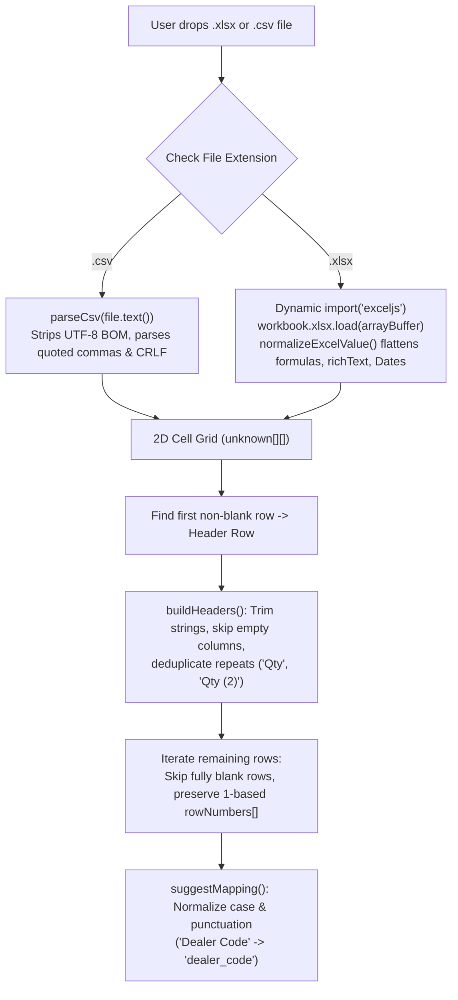
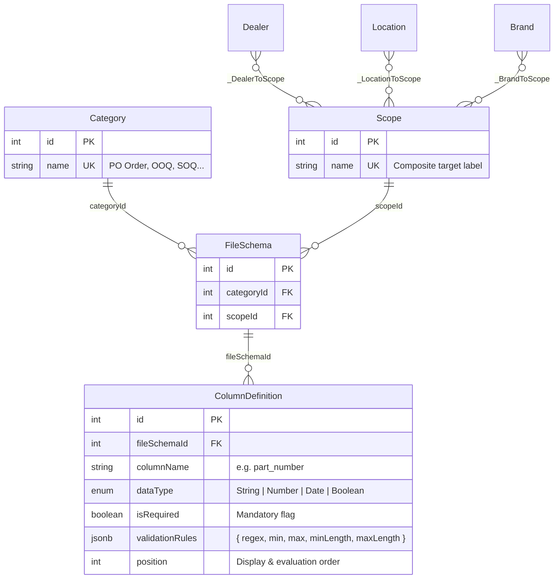
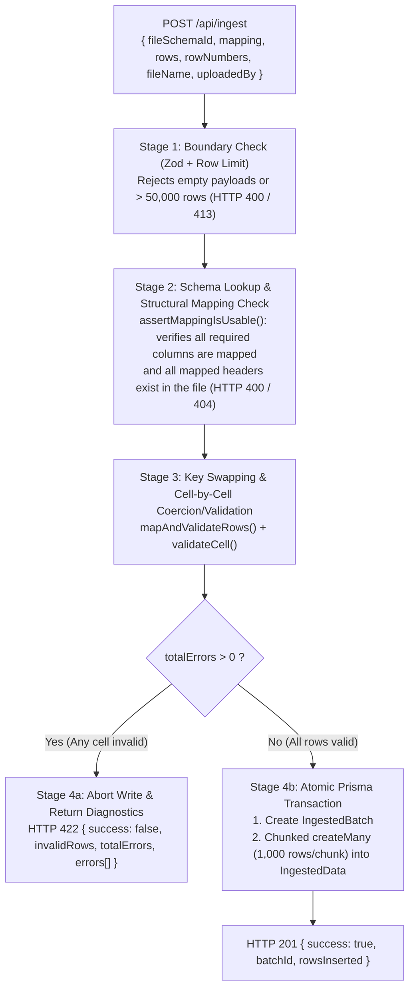

# Dynamic File Ingestion & Mapping POC — Architecture & Implementation Guide

> [!NOTE]
> A synchronized copy of this guide is also stored in your repository at [POC_DOCUMENTATION.md](file:///home/dmi12/POC/POC_DOCUMENTATION.md).

---

## 1. Overview & Problem Solved

Business operations regularly ingest spreadsheets across multiple document categories (**PO Order**, **OOQ**, **SOQ**, **MRN**, **STN**) targeted at specific **Dealers**, **Locations**, **Brands**, or multi-select combinations of all three. Each combination can require different columns, data types, and validation rules, while uploaded files often arrive with varying column headers.

This POC demonstrates a **completely decoupled frontend + backend architecture** that lets administrators configure schemas dynamically at runtime and lets users map, validate, and store data in a strict **PostgreSQL** database—**without ever running dynamic `CREATE TABLE` (DDL) queries**.

---

## 2. Deep Dive: Core Engineering Mechanics

### 2.1 How Columns & Headers Are Extracted (Client-Side)

Column extraction happens **100% in the browser** inside [parseSpreadsheet.ts](file:///home/dmi12/POC/frontend/lib/utils/parseSpreadsheet.ts) and [parseCsv.ts](file:///home/dmi12/POC/frontend/lib/utils/parseCsv.ts) before any network call is made to the backend:



1. **Format-Specific Parsing into a Uniform 2D Grid:**
   - **For `.xlsx` files** ([parseSpreadsheet.ts](file:///home/dmi12/POC/frontend/lib/utils/parseSpreadsheet.ts#L33-L46)): `ExcelJS` is lazy-loaded via `await import("exceljs")` and reads the `File` `ArrayBuffer`. `normalizeExcelValue()` unwraps Excel-specific cell objects (formula `{ result }`, `{ richText }`, hyperlinks `{ text }`, and `Date` instances converted to ISO strings) into plain primitives.
   - **For `.csv` files** ([parseCsv.ts](file:///home/dmi12/POC/frontend/lib/utils/parseCsv.ts#L5-L50)): A state-machine RFC 4180 parser strips any leading UTF-8 BOM (`0xFEFF`) and parses quoted fields, escaped quotes (`""`), and commas/newlines inside quotes into a 2D array.
2. **Header Row Discovery & Deduplication (`buildHeaders`):**
   - Instead of assuming row 1 is always non-empty, `gridToSpreadsheet()` scans for the **first non-blank row** and treats it as the header row ([parseSpreadsheet.ts](file:///home/dmi12/POC/frontend/lib/utils/parseSpreadsheet.ts#L64-L66)).
   - Blank header cells are ignored, whitespace is trimmed, and duplicate header names in the same sheet are automatically disambiguated (`"Qty"`, `"Qty (2)"`) while recording each header's column index ([parseSpreadsheet.ts](file:///home/dmi12/POC/frontend/lib/utils/parseSpreadsheet.ts#L49-L61)).
3. **Row Extraction & Original Row-Number Tracking:**
   - Every subsequent row is converted into a raw key-value object `{ [extractedHeader]: cellValue }`.
   - Completely blank rows are skipped, while `rowNumbers: number[]` records the **exact 1-based spreadsheet row number** (`r + 1`) for every kept data row ([parseSpreadsheet.ts](file:///home/dmi12/POC/frontend/lib/utils/parseSpreadsheet.ts#L71-L80)). This guarantees that if row 4 in Excel is blank and row 5 has an error, the backend reports **Row 5**, not Row 4.
4. **Intelligent Header Auto-Matching (`suggestMapping`):**
   - When the user enters Step 3, [autoMap.ts](file:///home/dmi12/POC/frontend/lib/utils/autoMap.ts#L11-L32) normalizes both the schema's `columnName` and the file's extracted `headers` by lowercasing and stripping all non-alphanumeric characters (`value.toLowerCase().replace(/[^a-z0-9]/g, "")`).
   - File header `"Dealer Code"` (`dealercode`) automatically binds to schema column `dealer_code` (`dealercode`), and `"OrderDate"` binds to `order_date`.
5. **Calculated Columns (`formula.ts` & `computedColumns.ts`):**
   - Users can derive new columns directly in Step 2 using arithmetic expressions over uploaded columns (`+`, `-`, `*`, `/`, parentheses, and `ROUND`/`ABS`/`MIN`/`MAX`), e.g., `Current Stock = [Opening Stock] + [Received] - [Issued]` ([formula.ts](file:///home/dmi12/POC/frontend/lib/utils/formula.ts), [computedColumns.ts](file:///home/dmi12/POC/frontend/lib/utils/computedColumns.ts)).
   - Evaluated values are appended to `headers` and each row in `rows` before filtering and mapping.
6. **Multi-Select & Combined-Column Row Filtering (`rowFilters.ts`):**
   - Right after parsing (and after calculated columns are evaluated), [RowFiltersPanel.tsx](file:///home/dmi12/POC/frontend/components/ingestion/RowFiltersPanel.tsx) and [rowFilters.ts](file:///home/dmi12/POC/frontend/lib/utils/rowFilters.ts) allow the user to filter which spreadsheet rows are kept:
     - **Single-Column Distinct Value Multi-Select:** Pick any column (e.g., `Dealer Code`) to display all distinct values and their row counts (`Apex Motors (12)`, `Metro Auto (5)`), and multi-select which values to keep.
     - **Combined-Column Tuple Filtering:** Click 2 or more columns together (e.g., `Dealer Code` + `Location Code`) to extract distinct composite keys (`Apex Motors · Mumbai`, `Apex Motors · Pune`) and multi-select specific combinations.
     - **Calculated-Column Filtering:** Calculated columns (e.g., `Current Stock`) also appear in the filter column picker and can be filtered on or combined with other columns.
   - `applyRowFilters()` filters `rows` and `rowNumbers` in lockstep so the Step 2 preview, Step 3 mapping, and Step 4 backend submission (`POST /api/ingest`) only validate and insert the filtered rows while preserving their original 1-based Excel/CSV row numbers.
7. **On-the-Fly System Columns & Custom Default Values (`NewSystemColumnPanel.tsx` & `prepareIngestionPayload.ts`):**
   - In Step 3 (`Map columns`), users can click **"+ Add new system column"** ([NewSystemColumnPanel.tsx](file:///home/dmi12/POC/frontend/components/ingestion/NewSystemColumnPanel.tsx)) to persist a new `ColumnDefinition` to the active `FileSchema` (`POST /api/file-schemas/:id/columns`) and immediately populate it either by mapping a file/calculated column or by assigning a **custom default value** (e.g., `"WEST-HUB"`).
   - Every system column in [`MappingRow`](file:///home/dmi12/POC/frontend/components/ingestion/MappingRow.tsx) also supports a **Custom Default Value** input:
     - When no file header is mapped, the custom default value is applied to every row (and satisfies mandatory columns).
     - When a file header is mapped alongside a custom default value, blank cells in that file column automatically fall back to the default value.
8. **Pre-Upload Changes Summary & Insertion Data Preview (`ChangesSummaryPanel.tsx` & `InsertionPreviewTable.tsx`):**
   - Before clicking **Submit & insert data**, Step 4 ([SubmitStep.tsx](file:///home/dmi12/POC/frontend/components/ingestion/SubmitStep.tsx)) uses [`prepareIngestionPayload()`](file:///home/dmi12/POC/frontend/lib/utils/prepareIngestionPayload.ts) to display:
     - **Summary of All Changes & Transformations:** Active row filters, calculated columns, newly added system columns, custom default values, and column mapping sources ([ChangesSummaryPanel.tsx](file:///home/dmi12/POC/frontend/components/ingestion/ChangesSummaryPanel.tsx)).
     - **Data to Be Inserted Table:** The exact transformed `IngestedData.rowData` records keyed by target system `columnName`, highlighting cells populated from calculated formulas or custom default values ([InsertionPreviewTable.tsx](file:///home/dmi12/POC/frontend/components/ingestion/InsertionPreviewTable.tsx)).
9. **Scope-Level Saved Mapping & Calculated Columns in PostgreSQL (`FileSchema.savedMapping`):**
   - Each `FileSchema` (`Category + Scope`) includes a `savedMapping` (`JSONB`) column in PostgreSQL ([schema.prisma](file:///home/dmi12/POC/backend/prisma/schema.prisma#L68)) managed via `PUT /api/file-schemas/:id/mapping` ([fileSchemaRoutes.ts](file:///home/dmi12/POC/backend/src/routes/fileSchemaRoutes.ts#L89-L125)) and atomic save-on-ingest in [`ingestRows()`](file:///home/dmi12/POC/backend/src/services/ingestionService.ts#L80-L103).
   - In Step 3 and Step 4 ([MappingPersistenceControl.tsx](file:///home/dmi12/POC/frontend/components/ingestion/MappingPersistenceControl.tsx)), users choose between:
     - **Store this mapping for future use (Save to DB):** Persists `mapping`, `defaultValues`, and `computedColumns` in PostgreSQL for that Category + Scope.
     - **Map for now (This upload only):** Uses the mapping only for the current upload without altering the saved database template.
   - When uploading a new file for a scope that already has a saved mapping in PostgreSQL, [`resolveSavedMapping()`](file:///home/dmi12/POC/frontend/lib/utils/savedMapping.ts) automatically restores all calculated columns, column mappings, and default values in Step 2 and offers a one-click **"Skip mapping -> Preview"** shortcut when all mandatory columns are satisfied.

---

### 2.2 How the Dynamic Schema Is Managed (Zero Runtime DDL)

Instead of executing `CREATE TABLE` or `ALTER TABLE` when an administrator defines a new document template, **schemas and columns are stored as rows in relational metadata tables** ([schema.prisma](file:///home/dmi12/POC/backend/prisma/schema.prisma)):



1. **Composite Target Scopes (`Scope` + `Dealer` / `Location` / `Brand`):**
   - A `Scope` represents a specific business target: a single dealer, multiple dealers, specific locations, specific brands, or any combination of all three ([scopeRoutes.ts](file:///home/dmi12/POC/backend/src/routes/scopeRoutes.ts)).
   - Prisma manages three SQL join tables (`_DealerToScope`, `_LocationToScope`, `_BrandToScope`).
   - When an admin composes a Scope without a custom name, `resolveScopeName()` generates a canonical summary (e.g., `Apex Motors, Metro Auto Group · Mumbai - West · Toyota`) and automatically reuses an existing `Scope` if the exact same set of `dealerIds`, `locationIds`, and `brandIds` already exists ([scopeRoutes.ts](file:///home/dmi12/POC/backend/src/routes/scopeRoutes.ts#L78-L98)).
2. **Joining Category + Scope (`FileSchema`):**
   - `FileSchema` enforces a composite unique constraint `@@unique([categoryId, scopeId])` ([schema.prisma](file:///home/dmi12/POC/backend/prisma/schema.prisma#L71)). Each Category + Scope pair has at most one active schema.
   - The Upload Wizard resolves the active schema in one query via `GET /api/file-schemas/lookup?categoryId=&scopeId=` ([fileSchemaRoutes.ts](file:///home/dmi12/POC/backend/src/routes/fileSchemaRoutes.ts#L42-L53)).
3. **Dynamic Column Rules (`ColumnDefinition`):**
   - Each column belongs to a `FileSchema` (`@@unique([fileSchemaId, columnName])`) and stores:
     - `columnName`: Canonical system key (e.g., `part_number`, `quantity`).
     - `dataType`: PostgreSQL enum (`String`, `Number`, `Date`, `Boolean`).
     - `isRequired`: Boolean flag indicating whether the column must be mapped and non-empty.
     - `validationRules`: Nullable `JSONB` object validated on write by Zod `superRefine` ([schemas.ts](file:///home/dmi12/POC/backend/src/lib/schemas.ts#L40-L75)) to ensure regex patterns compile and numeric/date bounds match the chosen `dataType`.
     - `position`: Auto-incremented integer (`_max.position + 1`) so columns always render and validate in a deterministic order.

---

### 2.3 How Data Is Stored (Relational Metadata + PostgreSQL `JSONB`)

Uploaded data is split across two relational tables in [schema.prisma](file:///home/dmi12/POC/backend/prisma/schema.prisma#L89-L110):

1. **`IngestedBatch` (Relational Upload Header):**
   - Stores the relational context of the upload event:
     - `id` (PK)
     - `fileSchemaId` (FK -> `FileSchema`, which links to `Category`, `Scope`, `Dealers`, `Locations`, and `Brands`)
     - `uploadDate` (`DateTime`)
     - `uploadedBy` (`String`)
     - `fileName` (`String?`)
     - `rowCount` (`Int`)
2. **`IngestedData` (Row-Level Storage with Binary `JSONB`):**
   - Stores one record per validated spreadsheet row:
     - `id` (PK)
     - `batchId` (FK -> `IngestedBatch`, indexed via `@@index([batchId])` with `onDelete: Cascade`)
     - `rowNumber` (`Int` — the original 1-based Excel/CSV row number)
     - `rowData` (`Json` / PostgreSQL `JSONB` — stores the remapped, type-coerced key-value pairs using the schema's canonical `columnName` keys)

#### Example Stored Record in `IngestedData`
If the uploaded Excel file had headers `PartNum`, `Dealer Code`, `Qty`, `OrderDate`, and `ExtraIgnoredColumn`, the user's mapping transforms and stores the row in `IngestedData` as:

```json
{
  "id": 42,
  "batchId": 7,
  "rowNumber": 2,
  "rowData": {
    "part_number": "AB-100",
    "dealer_code": "D1",
    "location_code": "MUM-W",
    "brand_name": "Toyota",
    "quantity": 25,
    "order_date": "2026-03-01T00:00:00.000Z",
    "is_urgent": true
  }
}
```

> [!TIP]
> **Why `JSONB` Instead of Runtime `CREATE TABLE` or EAV?**
> - **Safe & Migration-Free:** Adding or modifying a column in the Admin UI is a single `INSERT`/`UPDATE` on `ColumnDefinition`—no table locks or runtime DDL.
> - **Coerced Native JSON Types:** Numbers are stored as JSON numbers (`25`, not `"25"`), booleans as `true`/`false`, dates as ISO-8601 strings, and unmapped/empty optional columns as `null`.
> - **Full SQL Queryability:** PostgreSQL's binary `JSONB` supports GIN indexing and direct SQL predicates such as:
>   ```sql
>   SELECT id, "rowNumber", "rowData"->>'part_number' AS part_number
>   FROM "IngestedData"
>   WHERE "batchId" = 7
>     AND ("rowData"->>'quantity')::numeric >= 10;
>   ```

---

### 2.4 How Data Is Validated & Inserted (Step-by-Step Pipeline)

When the frontend submits `POST /api/ingest` ([ingestionRoutes.ts](file:///home/dmi12/POC/backend/src/routes/ingestionRoutes.ts#L17-L32)), the backend executes a strict 5-stage pipeline inside [ingestionService.ts](file:///home/dmi12/POC/backend/src/services/ingestionService.ts), [rowMapper.ts](file:///home/dmi12/POC/backend/src/services/rowMapper.ts), and [cellValidator.ts](file:///home/dmi12/POC/backend/src/services/cellValidator.ts):



1. **Stage 1 — Envelope & Payload Limit Validation** ([ingestionRoutes.ts](file:///home/dmi12/POC/backend/src/routes/ingestionRoutes.ts#L19-L27)):
   - `ingestBodySchema` (Zod) validates `fileSchemaId`, `mapping`, `rows`, and `rowNumbers`.
   - Enforces `config.maxIngestRows` (`50,000` rows) and verifies `rowNumbers.length === rows.length`.
2. **Stage 2 — Schema Lookup & Structural Mapping Guard (`assertMappingIsUsable`)** ([ingestionService.ts](file:///home/dmi12/POC/backend/src/services/ingestionService.ts#L85-L103)):
   - Loads the `FileSchema` and its ordered `ColumnDefinition`s from PostgreSQL.
   - Before touching individual cells, verifies three structural invariants:
     1. Every key in `mapping` belongs to the schema's `ColumnDefinition`s.
     2. Every column marked `isRequired: true` has a non-empty file header in `mapping` (`findUnmappedRequired`).
     3. Every mapped file header actually exists in the uploaded rows.
3. **Stage 3 — Key Swapping & Cell Coercion/Validation (`mapAndValidateRows` & `validateCell`)** ([rowMapper.ts](file:///home/dmi12/POC/backend/src/services/rowMapper.ts#L37-L78), [cellValidator.ts](file:///home/dmi12/POC/backend/src/services/cellValidator.ts#L87-L120)):
   - Iterates through every row and every `ColumnDefinition`:
     - Looks up `sourceHeader = mapping[column.columnName]` and reads `raw = rawRow[sourceHeader]`.
     - Unmapped file columns are automatically dropped; unmapped optional schema columns become `null`.
     - `validateCell(raw, column)` checks:
       - **Empty check:** `null`, `undefined`, or whitespace-only `""` fails with `"Required value is missing"` if `isRequired` is `true`, or coerces to `null` if optional.
       - **`Number`:** Strips commas (`"1,000"` -> `1000`), verifies `Number.isFinite`, and checks `min` / `max`.
       - **`Boolean`:** Coerces booleans or case-insensitive `"true"/"yes"/"y"/"1"` -> `true` and `"false"/"no"/"n"/"0"` -> `false`.
       - **`Date`:** Requires a valid `YYYY-MM-DD` / ISO date (or `Date` object), converts to `.toISOString()`, and checks `min` / `max` date bounds.
       - **`String`:** Trims whitespace and enforces `minLength`, `maxLength`, and `new RegExp(rules.regex)`.
   - Any cell failure increments `totalErrors` and appends a structured `RowError` (`{ row, column, sourceHeader, value, message }`, capped at `500` detailed items in the response payload).
4. **Stage 4 — All-or-Nothing Gate** ([ingestionService.ts](file:///home/dmi12/POC/backend/src/services/ingestionService.ts#L50-L58)):
   - If `totalErrors > 0`, **zero database writes occur** and the endpoint responds with `HTTP 422` containing the error array so the user can inspect and fix the exact rows/columns.
5. **Stage 5 — Atomic Transaction & Chunked Bulk Insert** ([ingestionService.ts](file:///home/dmi12/POC/backend/src/services/ingestionService.ts#L60-L80)):
   - When `totalErrors === 0`, `prisma.$transaction` runs with a 60-second timeout:
     1. Creates the parent `IngestedBatch` row (`fileSchemaId`, `uploadedBy`, `fileName`, `rowCount`).
     2. Inserts `validRows` into `IngestedData` in chunks of **`1,000` rows per `tx.ingestedData.createMany()` call** to stay well below PostgreSQL's bind-parameter limit while achieving high bulk-insert throughput.
     3. If any chunk fails, PostgreSQL rolls back the entire transaction—preventing partial batches.

### 2.5 Calculated Columns (Arithmetic on Uploaded Columns)

Sometimes a system column such as `current_stock` does not exist in the file and must be **derived**, e.g. `Opening Stock + Received − Issued`. This happens in the browser, in **Step 2 right after the file is parsed**, so the backend needs no changes.


1. **Define:** under the file preview in Step 2, the **Calculated columns** form is open by default. Pick the system column to map to (optional), and build the formula by clicking column chips and operators, e.g. `[Opening Stock] + [Received] - [Issued]`. A live preview shows the first rows, and once added, the new column is highlighted in the preview table.
2. **Evaluate safely** ([formula.ts](file:///home/dmi12/POC/frontend/lib/utils/formula.ts)): a recursive-descent parser builds an AST. Supported: `+ - * / %`, unary minus, parentheses and `ABS`, `ROUND`, `MIN`, `MAX`. Nothing is passed to `eval` or `Function`, so formulas cannot run code.
3. **Apply** ([computedColumns.ts](file:///home/dmi12/POC/frontend/lib/utils/computedColumns.ts)): `applyComputedColumns()` appends each result as a normal column, so preview, mapping and submit treat it like any file column. If you chose a target system column it is already mapped when you reach Step 3. Later formulas can use earlier results; removing a column also removes dependents.
4. **Blank and bad values:** numeric strings such as `"1,000"` are converted. Blank cells count as 0 by default (switchable per column). Non-numeric text or division by zero gives a blank result, which the backend then flags as `Required value is missing` (or stores `null` if optional) with the original spreadsheet row number.
5. **Store:** the result is sent as a normal mapped value and ends up in `IngestedData.rowData` like any other column. Formulas themselves are not persisted; they live only for the current upload session.

---

## 3. Features Covered Across the UI

### 3.1 Admin Configuration Workspace (`/admin`)
- **Master Data Catalogs** ([CatalogPanel.tsx](file:///home/dmi12/POC/frontend/components/admin/CatalogPanel.tsx)): CRUD for **Categories**, **Dealers**, **Locations**, and **Brands**.
- **Multi-Target Scope Builder** ([ScopeBuilderPanel.tsx](file:///home/dmi12/POC/frontend/components/admin/ScopeBuilderPanel.tsx), [MultiSelectChips.tsx](file:///home/dmi12/POC/frontend/components/admin/MultiSelectChips.tsx)): Multi-select any combination of specific Dealers, Locations, and/or Brands to form a Scope.
- **Figma-Style Schema Builder** ([SchemaWorkspace.tsx](file:///home/dmi12/POC/frontend/components/admin/SchemaWorkspace.tsx), [NewSchemaPicker.tsx](file:///home/dmi12/POC/frontend/components/admin/NewSchemaPicker.tsx), [SchemaEditor.tsx](file:///home/dmi12/POC/frontend/components/admin/SchemaEditor.tsx)): Two-pane *Layers + Inspector* interface for managing schemas and column rules.

### 3.2 End-User Upload & Mapping Wizard (`/upload`)
- **Step 1 — Context & Target Scope Filtering** ([ContextStep.tsx](file:///home/dmi12/POC/frontend/components/ingestion/ContextStep.tsx)): Cascading Category selector + Dealer/Location/Brand filters + visual Scope cards.
- **Step 2 — Client-Side File Parsing & Preview** ([UploadStep.tsx](file:///home/dmi12/POC/frontend/components/ingestion/UploadStep.tsx), [DataPreview.tsx](file:///home/dmi12/POC/frontend/components/ingestion/DataPreview.tsx)): Browser-parsed `.xlsx`/`.csv` upload with 5-row preview and optional formula-based calculated columns ([ComputedColumnsPanel.tsx](file:///home/dmi12/POC/frontend/components/ingestion/ComputedColumnsPanel.tsx), section 2.5).
- **Step 3 — Header Extraction & Smart Mapping** ([MappingStep.tsx](file:///home/dmi12/POC/frontend/components/ingestion/MappingStep.tsx), [MappingRow.tsx](file:///home/dmi12/POC/frontend/components/ingestion/MappingRow.tsx)): Interactive mapping with sample values, auto-match, and mandatory progress bar. Calculated columns from Step 2 appear as normal headers.
- **Step 4 — All-or-Nothing Validation & Error Diagnostics** ([SubmitStep.tsx](file:///home/dmi12/POC/frontend/components/ingestion/SubmitStep.tsx), [ValidationErrorTable.tsx](file:///home/dmi12/POC/frontend/components/ingestion/ValidationErrorTable.tsx)): Summary review, submission, and cell-level error diagnostics.

### 3.3 Database & Ingested Data Explorer (`/data`)
- **Ingested Batches & JSONB Table Viewer** ([DataExplorer.tsx](file:///home/dmi12/POC/frontend/components/explorer/DataExplorer.tsx)): Browse uploaded batches, inspect dynamic columns and rows stored in `IngestedData.rowData`, toggle raw JSONB output, and review all SQL tables.

---

## 4. Tech Stack & Libraries (What & Why)

### 4.1 Backend (`/backend`)

| Library | Version | Purpose in This POC | Why We Chose It |
|---|---|---|---|
| **Express** | `^5.3.0` | Standalone REST API server ([app.ts](file:///home/dmi12/POC/backend/src/app.ts)) | Completely decoupled from the frontend; handles large JSON row payloads (`50mb` limit) and clean REST routing. |
| **PostgreSQL 16** | `16` | Relational SQL database ([docker-compose.yml](file:///home/dmi12/POC/docker-compose.yml)) | Enforces strict relational constraints on schemas/scopes while supporting native binary `JSONB` for dynamic row storage without runtime `CREATE TABLE` DDL. |
| **Prisma ORM** | `^6.19.3` | Database modeling, migrations, and queries ([schema.prisma](file:///home/dmi12/POC/backend/prisma/schema.prisma)) | Provides type-safe relational queries, manages the many-to-many join tables (`_DealerToScope`, `_LocationToScope`, `_BrandToScope`), and wraps batch ingestion in atomic transactions (`prisma.$transaction`). |
| **Zod** | `^4.6.7` | Request body & query validation ([schemas.ts](file:///home/dmi12/POC/backend/src/lib/schemas.ts)) | Validates all incoming payloads and runs custom `superRefine` checks (e.g., verifying that admin-supplied regex patterns are valid before saving a column). |
| **cors** | `^2.8.6` | Cross-Origin Resource Sharing | Required because the UI (`localhost:3000`) and API (`localhost:4000`) run as separate services on different ports/origins. |
| **dotenv** | `^18.0.9` | Environment configuration | Loads `DATABASE_URL`, `PORT`, and `CORS_ORIGINS` from `.env`. |
| **TypeScript + tsx** | `^7.0.2` / `^4.23.15` | Type safety, hot-reload dev server, and unit test runner | Runs TypeScript directly and executes the validation unit tests ([validation.test.ts](file:///home/dmi12/POC/backend/src/services/validation.test.ts)) via Node's native test runner. |

### 4.2 Frontend (`/frontend`)

| Library | Version | Purpose in This POC | Why We Chose It |
|---|---|---|---|
| **Next.js (App Router)** | `16.4.4` | Standalone UI application (`/`, `/admin`, `/upload`, `/data`) | Matches your main project's framework (`Next.js 16 + React 19 + TypeScript`) while acting strictly as a client talking to the standalone API. |
| **React** | `19.3.0` | Interactive UI & custom hooks | Clean separation between presentation components and state hooks (`useCatalog`, `useScopes`, `useFileSchema`, `useSchemaList`). |
| **Tailwind CSS v4** | `^4` | Design tokens, Figma-like canvas UI, and responsive layouts ([globals.css](file:///home/dmi12/POC/frontend/app/globals.css)) | Provides custom `@theme` tokens, zero-runtime CSS, and seamless desktop-to-mobile responsiveness. |
| **ExcelJS** | `^4.4.0` | Client-side `.xlsx` parsing ([parseSpreadsheet.ts](file:///home/dmi12/POC/frontend/lib/utils/parseSpreadsheet.ts)) | Actively maintained, normalizes rich Excel cell values (formulas, dates, rich text), and is dynamically imported (`import("exceljs")`) only when an `.xlsx` file is selected. Chosen over npm `xlsx` which is outdated and has unpatched advisories. |
| **RFC 4180 CSV Parser** | Built-in | Client-side `.csv` parsing ([parseCsv.ts](file:///home/dmi12/POC/frontend/lib/utils/parseCsv.ts)) | Lightweight browser-native parser that handles UTF-8 BOM, quoted commas, escaped quotes, and multiline cells without needing Node streams in the browser. |
| **lucide-react** | `^1.67.0` | UI icons | Crisp, consistent iconography for the Figma-inspired sidebar, data-type pills, and wizard controls. |
| **clsx** | `^2.1.1` | Conditional class merging | Cleanly composes Tailwind state classes across buttons, badges, and mapping rows. |

---

## 5. How to Implement This in Your Main Project

### Step 1 — Merge the Database Schema
1. Copy the models from [schema.prisma](file:///home/dmi12/POC/backend/prisma/schema.prisma) (`Category`, `Dealer`, `Location`, `Brand`, `Scope`, `FileSchema`, `ColumnDefinition`, `IngestedBatch`, `IngestedData`, and `enum DataType`) into your project's Prisma schema.
2. If your project already has `Dealer`, `Location`, or `Brand` tables, simply add `scopes Scope[]` to your existing models so `Scope` joins directly against your live master records.
3. Run `npx prisma migrate dev --name add_dynamic_ingestion`.
4. *(Optional)* Add a PostgreSQL GIN index on `IngestedData.rowData` if you plan to filter inside ingested JSON rows:
   ```sql
   CREATE INDEX idx_ingested_data_jsonb ON "IngestedData" USING GIN ("rowData");
   ```

### Step 2 — Drop In the Backend Validation & Ingestion Engine
1. Copy the pure domain services into your backend:
   - [cellValidator.ts](file:///home/dmi12/POC/backend/src/services/cellValidator.ts) — type coercion & rule validation (`regex`, `min`, `max`, `minLength`, `maxLength`).
   - [rowMapper.ts](file:///home/dmi12/POC/backend/src/services/rowMapper.ts) — header key swapping & row error collection.
   - [ingestionService.ts](file:///home/dmi12/POC/backend/src/services/ingestionService.ts) — all-or-nothing validation and chunked transactional insert (`1,000` rows per batch).
2. Copy the route handlers ([catalogRoutes.ts](file:///home/dmi12/POC/backend/src/routes/catalogRoutes.ts), [scopeRoutes.ts](file:///home/dmi12/POC/backend/src/routes/scopeRoutes.ts), [fileSchemaRoutes.ts](file:///home/dmi12/POC/backend/src/routes/fileSchemaRoutes.ts), [ingestionRoutes.ts](file:///home/dmi12/POC/backend/src/routes/ingestionRoutes.ts)) and protect admin mutations with your auth/role middleware (`admin` for schema/scope mutations, authenticated user for `/api/ingest`).

### Step 3 — Integrate the Frontend Modules
1. Install the client dependencies in your Next.js app:
   ```bash
   npm install exceljs lucide-react clsx
   ```
2. Copy the modular layers into your Next.js project:
   - **Types:** [lib/types/index.ts](file:///home/dmi12/POC/frontend/lib/types/index.ts)
   - **Services:** [lib/services/](file:///home/dmi12/POC/frontend/lib/services/apiClient.ts) (`apiClient.ts`, `catalogService.ts`, `schemaService.ts`, `ingestionService.ts`) — attach your `Authorization: Bearer <token>` header from `useAuth()` inside `apiClient.ts`.
   - **Utilities:** [lib/utils/](file:///home/dmi12/POC/frontend/lib/utils/parseSpreadsheet.ts) (`parseSpreadsheet.ts`, `parseCsv.ts`, `autoMap.ts`, `columnForm.ts`)
   - **Hooks:** [hooks/](file:///home/dmi12/POC/frontend/hooks/useCatalog.ts) (`useCatalog.ts`, `useScopes.ts`, `useFileSchema.ts`, `useSchemaList.ts`)
   - **Components:** [components/admin/](file:///home/dmi12/POC/frontend/components/admin/AdminWorkspace.tsx), [components/ingestion/](file:///home/dmi12/POC/frontend/components/ingestion/IngestionWizard.tsx), [components/explorer/](file:///home/dmi12/POC/frontend/components/explorer/DataExplorer.tsx), and [components/shared/](file:///home/dmi12/POC/frontend/components/shared/ScopePills.tsx).
